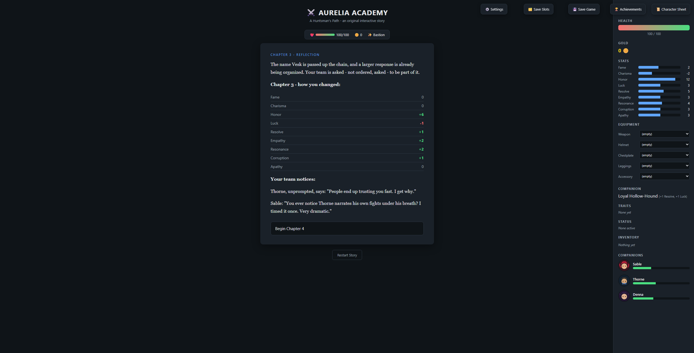

# Aurelia Academy: A Huntsman's Path

**[▶ Play it in your browser]((https://ztigerh.github.io/Academy-Game/))**



*(One or two sentences pitching your story here: who you play, what's at stake, and what makes the choices matter.)*

An original text-adventure RPG set in a combat academy for monster hunters. Your choices shape your stats, your allies, and how the story ends.

## What you'll find

- **A four-chapter story with 40 decisions** and three distinct endings, driven by nine hidden stats like Honor, Corruption, and Empathy
- **Three playable classes** that change how fights and skill checks play out
- **A companion system** with a recurring rival and an adoptable creature
- **Part Two:** your ending unlocks a career. Three jobs (Council Investigator, Bandit Crew Leader, Kingdom Guard Elite) have full four-chapter arcs with boss fights and their own endings, and six more have shorter epilogues, with more on the way
- **Full RPG systems:** dice-roll combat, equipment with durability, a shop and gambling den, three save slots, and achievements

## Under the hood

Built in vanilla HTML, CSS, and JavaScript with no build step and no dependencies. Open `index.html` in any modern browser, or host it on GitHub Pages.

```
index.html          page shell
css/style.css       all styling
js/engine.js        game state, rendering, UI (loads first)
js/scenes/          story chapters and job arcs
js/jobs-data.js     ending logic and shorter job epilogues
```

The three finished job arcs follow a pattern, and `js/scenes/council.js` is the cleanest template if you want to expand the other six.

Everything is loaded as plain `<script>` tags (no bundler, no modules) so the whole thing works by just opening the HTML file — no server required. `js/engine.js` must load first since it declares the shared `SCENES` object that each `js/scenes/*.js` file adds to.

## Contributing / extending

The remaining 6 jobs are built out to the same "single epilogue chapter" depth as the original design; expanding any of them to a full 4-chapter arc just means following the pattern already established in `js/scenes/council.js` (the smallest/cleanest of the three full arcs to use as a template).
